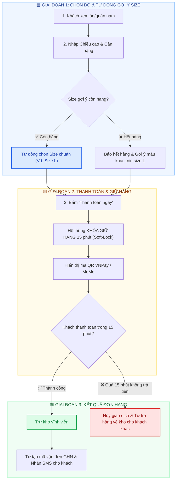

# TÀI LIỆU ĐẶC TẢ QUY TRÌNH NGHIỆP VỤ (BUSINESS PROCESS SPECIFICATION)

* **Tên dự án:** Nền tảng Thương mại Điện tử Quần Áo Nam Cao Cấp (Men's Apparel E-Commerce)
* **Tác giả / IT Business Analyst:** Lưu Văn Hoàng
* **Phiên bản:** v1.0
* **Ngày tạo:** 26/11/2026
* **Trạng thái:** Đã phê duyệt (Approved for Development)

---

## 1. BỐI CẢNH & MỤC TIÊU NGHIỆP VỤ (BUSINESS CONTEXT)

### 1.1. Bối cảnh bài toán Quần Áo Nam
Khách hàng mục tiêu là nam giới từ 20 – 45 tuổi với hành vi mua sắm đặc thù:
* **Quyết định nhanh (Fast Decision):** Không thích lướt xem quá nhiều trang, muốn thao tác chốt đơn trong vòng dưới 2 phút.
* **Ngại đo đạc thông số:** 85% nam giới không biết chính xác số đo vòng ngực, vòng bụng, vòng vai của mình và không có sẵn thước dây tại nhà.
* **Hệ quả của quy trình cũ:** Khách tự chọn bừa size theo thói quen &rarr; Tỷ lệ đổi trả hàng do mặc không vừa lên đến **28%**, làm tăng chi phí vận chuyển 2 chiều và gây ức chế tâm lý cho khách hàng.

### 1.2. Mục tiêu cải tiến của Quy trình mới (TO-BE Goals)
* Tự động hóa khâu tư vấn kích cỡ bằng thuật toán tính toán BMI & Phom dáng, giúp khách chọn size chuẩn trong **1 giây**.
* Giảm tỷ lệ đổi trả hàng do sai size từ 28% xuống dưới **9%** sau 3 tháng vận hành.
* Tự động hóa luồng đặt hàng và trừ kho, không để xảy ra tình trạng "bán khống" sản phẩm đã hết hàng.

---

## 2. SO SÁNH QUY TRÌNH AS-IS VÀ TO-BE (GAP ANALYSIS)

| Tiêu chí | Quy trình hiện tại (AS-IS) | Quy trình đề xuất mới (TO-BE) | Lợi ích kinh doanh |
| :--- | :--- | :--- | :--- |
| **Tư vấn chọn Size** | Khách tự soi bảng ảnh kích thước chung chung hoặc nhắn tin Fanpage chờ nhân viên trả lời (mất 15 - 30 phút). | Khách chỉ cần nhập Chiều cao & Cân nặng, hệ thống tự động tính toán và đề xuất size chuẩn xác ngay trên màn hình. | Rút ngắn thời gian chốt đơn, giảm 70% tải công việc cho nhân viên chat trực tuyến. |
| **Quản lý Tồn kho** | Kiểm kê thủ công cuối ngày trên Excel. Showroom bán hết hàng nhưng trên web vẫn cho khách bấm mua. | Đồng bộ tồn kho ma trận (Color x Size) Real-time. Tự động áp dụng cơ chế **Soft-Lock (Khóa tạm tồn kho 15 phút)** khi thanh toán. | Triệt tiêu 100% rủi ro bán vượt tồn kho (Over-selling). |
| **Phương thức Thanh toán** | Bắt buộc chuyển khoản thủ công chụp biên lai gửi nhân viên check duyệt, hoặc chỉ có COD. | Tích hợp mã QR động (VNPay / MoMo) quét xong tự động ghi nhận thanh toán trong 3 giây. | Tăng tỷ lệ thanh toán trước, giảm tỷ lệ bùng hàng / bom hàng khi ship COD. |
| **Tạo vận đơn giao hàng** | Nhân viên kho gõ tay địa chỉ khách vào app giao hàng (GHTK/GHN), dễ sai sót. | Hệ thống tự động gọi API đẩy đơn sang GHN ngay khi đơn thành công, in phiếu đóng gói tự động. | Tiết kiệm 80% thời gian xử lý đơn hàng tại kho. |

---

## 3. SƠ ĐỒ QUY TRÌNH NGHIỆP VỤ (FLOWCHART TRỰC QUAN & DỄ HIỂU)

> 💡 **Tóm tắt quy trình chỉ trong 3 chặng cơ bản:**  
> **Chặng 1 (Màu xanh dương):** Khách chọn đồ & Hệ thống tự động gợi ý Size.  
> **Chặng 2 (Màu vàng cam):** Khách bấm thanh toán & Hệ thống giữ hàng trong 15 phút.  
> **Chặng 3 (Màu xanh lá):** Hoàn tất đơn hàng (Nếu trả tiền thành công thì giao hàng, nếu quá hạn thì nhả hàng lại về kho).

---

## 4. ĐẶC TẢ CHI TIẾT TỪNG BƯỚC NGHIỆP VỤ (STEP-BY-STEP SPECIFICATION)

### Bước 1: Tiếp nhận yêu cầu & Nhập dữ liệu cơ thể
* **Tác nhân:** Khách hàng.
* **Giao diện:** Màn hình Chi tiết sản phẩm (Product Detail Page - PDP).
* **Dữ liệu đầu vào (Input):**
  * `Chieu_Cao`: Số nguyên dương từ `140` đến `210` (đơn vị: cm).
  * `Can_Nang`: Số nguyên dương từ `40` đến `130` (đơn vị: kg).
  * `Phom_Dang` (Tùy chọn): Vừa vặn (Regular) | Ôm nhẹ (Slim-fit) | Rộng thoải mái (Loose/Oversize).
* **Quy tắc kiểm tra hợp lệ (Validation Rules):**
  * Không cho phép nhập ký tự chữ hoặc số âm.
  * Nếu người dùng nhập ngoài khoảng cho phép &rarr; Báo lỗi: *"Vui lòng nhập chiều cao từ 140 - 210cm và cân nặng từ 40 - 130kg"*.

### Bước 2: Thuật toán đề xuất kích cỡ (Size Recommendation Logic)
* **Tác nhân:** Hệ thống Backend.
* **Công thức nghiệp vụ:**
  $$\text{BMI} = \frac{\text{Cân nặng (kg)}}{(\text{Chiều cao (m)})^2}$$
* **Bảng ánh xạ (Mapping Matrix) cho Áo Nam phom Regular:**
  * $\text{Chiều cao} \le 165\text{ cm}$ và $\text{Cân nặng} \le 55\text{ kg}$ &rarr; **Size S**
  * $\text{Chiều cao } 160 - 170\text{ cm}$ và $\text{Cân nặng } 56 - 65\text{ kg}$ &rarr; **Size M**
  * $\text{Chiều cao } 168 - 176\text{ cm}$ và $\text{Cân nặng } 66 - 74\text{ kg}$ &rarr; **Size L**
  * $\text{Chiều cao } 174 - 182\text{ cm}$ và $\text{Cân nặng } 75 - 83\text{ kg}$ &rarr; **Size XL**
  * $\text{Chiều cao } > 180\text{ cm}$ hoặc $\text{Cân nặng } > 84\text{ kg}$ &rarr; **Size XXL**
* **Xử lý biên (Borderline Cases):** Nếu thông số rơi vào ranh giới giữa 2 size (Ví dụ: 1m70, 65.5kg), hệ thống kiểm tra phom dáng:
  * Khách thích mặc ôm &rarr; Gợi ý size nhỏ hơn (Size M).
  * Khách thích mặc rộng &rarr; Gợi ý size lớn hơn (Size L).

### Bước 3: Cơ chế Giữ hàng tồn kho tạm thời (Soft-Lock Inventory)
* **Mục đích:** Tránh xung đột dữ liệu (Race Condition) khi 2 khách hàng cùng đặt chiếc áo cuối cùng trong kho.
* **Quy tắc logic:**
  * Ngay khi khách bấm *"Tiến hành Thanh toán"*, hệ thống cập nhật trường `Locked_Quantity` tăng lên 1, `Available_Quantity` giảm đi 1.
  * Thiết lập bộ đếm thời gian đếm ngược: **15 phút (900 giây)**.
  * Nếu nhận được tín hiệu thanh toán thành công từ VNPay &rarr; Chuyển `Locked_Quantity` sang trừ trực tiếp vào `Real_Stock`.
  * Nếu hết 900 giây mà chưa thanh toán &rarr; Hệ thống tự động kích hoạt tiến trình nền (Cronjob) hoàn trả `Available_Quantity` về trạng thái ban đầu.

---

## 5. BỘ CÂU HỎI PHỎNG VẤN THỰC TẾ & CÁCH TRẢ LỜI CỦA IT BA

Khi nhà tuyển dụng xem tài liệu Bước 1 này, họ thường hỏi bạn các câu hỏi sau:

> **Câu hỏi 1:** *"Tại sao em lại chọn cơ chế Soft-lock 15 phút mà không trừ kho ngay khi khách thêm vào giỏ hàng?"*  
> **Cách bạn trả lời:**  
> *"Dạ thưa anh/chị, nếu trừ kho ngay khi khách 'Thêm vào giỏ' thì những khách hàng ảo hoặc đối thủ có thể bấm thêm hàng loạt vào giỏ để làm ảo hết hàng trên web, khiến khách hàng thật không mua được. Ngược lại, nếu đợi thanh toán xong mới trừ kho thì xảy ra rủi ro 2 người cùng quét tiền cho 1 chiếc áo duy nhất. Vì vậy, mốc thời gian khách bắt đầu mở mã QR thanh toán là thời điểm hợp lý nhất để Soft-lock 15 phút, đủ để khách quét app ngân hàng mà không giam hàng quá lâu."*

> **Câu hỏi 2:** *"Nếu bảng gợi ý size tính ra khách mặc size L, nhưng kho chỉ còn size M hoặc XL thì luồng nghiệp vụ xử lý thế nào?"*  
> **Cách bạn trả lời:**  
> *"Dạ, em thiết kế hệ thống luôn kiểm tra tồn kho tức thì trước khi hiển thị. Nếu Size L hết hàng ở màu khách đang chọn, hệ thống sẽ hiển thị gợi ý thông minh: 'Size L vừa với bạn nhưng màu này đã tạm hết, bạn có thể tham khảo màu Xanh hoặc để lại số điện thoại khi có hàng'. Đồng thời, nút Thêm vào giỏ của biến thể đó bị vô hiệu hóa để ngăn chặn lỗi đơn hàng."*

---

*Tài liệu được hoàn thiện bởi Lưu Văn Hoàng – Sẵn sàng chuyển tiếp sang Bước 2 (Đặc tả User Story chuẩn Gherkin).*
